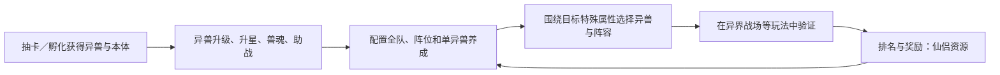
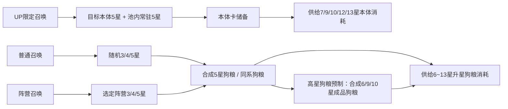
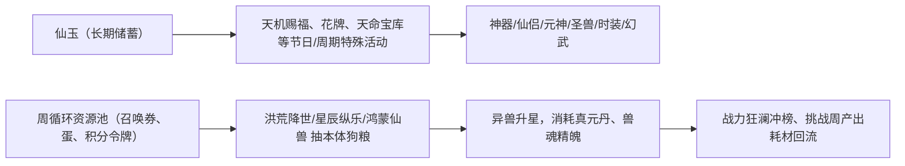

# 《山海经异兽录》异兽阵容养成系统拆解
> 系统策划求职作品集｜分析对象：App庆典服正式版本｜更新日期：2026-10-21
> 文档定位：策划逆向系统拆解，基于完整游戏体验 + 升星材料表 + 周活动排期 + 仙玉经济规则整理；无逆向抓包，不包含后台数值公式，所有消耗数据以游戏内UI展示为准。

---

## 目录
1. [系统概述与核心循环](#1-系统概述与核心循环)
2. [系统边界与模块解耦](#2-系统边界与模块解耦)
3. [异兽升星养成系统](#3-异兽升星养成系统)
4. [异兽抽卡系统](#4-异兽抽卡系统)
5. [周活动排期与资源投放节奏](#5-周活动排期与资源投放节奏)
6. [仙玉经济与全链路资源总览](#6-仙玉经济与全链路资源总览)
7. [系统综合评价与优化建议](#7-系统综合评价与优化建议)
8. [拓展核验清单](#8-拓展核验清单)

---

## 1. 系统概述与核心循环

### 1.1 系统定位
异兽阵容养成是本作的**核心成长主系统**，承担三项产品目标：
- **业务目标**：驱动中长期玩家留存，搭建零氪-微氪-重氪的付费梯度；通过多线养成制造玩家策略选择空间；通过PVP闭环消耗养成产出。
- **体验目标**：提供持续的成长正向反馈，设置合理成长卡点，让玩家围绕属性流派做阵容构筑决策。
- **上下游关系**：上游由抽卡、孵化、周活动供给异兽本体与养成材料；下游把养成输出交付编队、异界战场PVP；PVP产出仙侣资源反向增益全队，形成闭环。

### 1.2 核心循环


### 1.3 核心设计逻辑
本游戏区别于普通卡牌的关键点：**战力面板只是结果展示，实战强度由多层养成叠加 + 赛季环境共同决定**。
玩家的核心决策不是简单"养最强卡"，而是在异兽本体、兽魂、助战、阵位、全队增益之间分配有限的异兽本体与仙玉资源，堆出暴击/格挡/闪避等目标对抗属性，再放到PVP中检验构筑效果。

---

## 2. 系统边界与模块解耦

> 参考系统解耦思路：区分【本系统内部模块】【依赖外部系统】【上游输入】【下游输出】，清晰定义系统接口，而不是简单罗列全部功能。

| 层级 | 机制说明 | 拆解定位 |
| --- | --- | --- |
| 异兽本体 | 升级、升星；星级锁定等级上限，技能随等级自动升级；升星消耗同名本体 + 指定阵营/星级的材料异兽。 | **核心内部模块**：卡牌成长门槛、资源消耗逻辑 |
| 兽魂、助战 | 兽魂消耗异兽本体解锁、升星，产出特殊属性；上阵异兽绑定1只高星助战异兽，继承部分基础属性。 | **核心内部模块**：异兽本体资源二次分配，单卡定向增益 |
| 神兵、神通、法则、神碑 | 穿戴配置在异兽身上，修改单异兽属性、套装效果。 | **外部依赖系统**：仅分析与异兽阵容的调用接口 |
| 法阵 | 上阵1套法阵，阵眼+4护法位，不同阵位差异化加成，自带法阵技能。 | **外部依赖系统**：将养成收益和站位策略绑定 |
| 神器、仙侣 | 神器最多上阵3件，按回合释放技能；仙侣1主战2助战，提供全队属性，三星解锁神魔。 | **外部依赖系统**：提供全局全队增益 |
| 抽卡、仙麟孵化、专题活动 | 产出异兽本体；仙玉兑换各类养成材料。 | **上游输入**：控制养成对象与资源供给节奏 |
| 编队、异界战场 | 把养成结果投入实战；产出个人/势力积分与排名奖励。 | **下游输出**：验证阵容强度，回流增益类养成资源 |

```text
异兽阵容养成
├─ 本体成长：获取 → 升级 → 升星 → 等级上限 → 技能随等级提升
├─ 本体再分配：同名本体用于升星／兽魂；消耗阵营星级匹配的材料异兽
├─ 单体配置：助战、兽魂、神兵、神通、法则、神碑
├─ 阵位配置：法阵选择、阵眼与护法位置
└─ 全队配置：神器、仙侣
```

> 边界说明：本文聚焦「异兽本体成长 - 单体增益 - 阵容实战验证」链路；法阵、仙侣、神器仅做接口分析，完整规则可独立拆分为另外文档。

---

## 3. 异兽升星养成系统

> 模块归属：核心成长系统
> 基础定义
> - 五星本体：目标异兽的5星卡牌（5→13星阶段使用）
> - 六星本体：目标异兽的6星卡牌（13→18星超限阶段使用）
> - 同系卡：同一阵营卡牌；任意卡：无阵营限制卡牌
> - 狗粮：作为升星消耗、不进入主力阵容的卡牌
> - 真元丹、兽魂精魄：升星配套通用养成资源，全阶段消耗递增
> - 创世族：特殊独立成长线，消耗万能碎片、神兽精魄，规则和普通异兽隔离

### 3.1 普通异兽升星消耗总表（5星→18星）
| 阶段 | 本体类型 | 本体数量 | 5星同系 | 任意5星 | 6星同系 | 任意9星 | 任意10星 | 真元丹 | 兽魂精魄 |
| ---- | ---- | ---- | ---- | ---- | ---- | ---- | ---- | ---- | ---- |
| 5升6 | 五星本体 | - | 2 | 2 | - | - | - | - | - |
| 6升7 | 五星本体 | 1 | - | 3 | - | - | - | 500 | - |
| 7升8 | 五星本体 | - | - | 3 | 1 | - | - | 1500 | - |
| 8升9 | 五星本体 | 1 | 3 | 2 | 1 | - | - | 5000 | - |
| 9升10 | 五星本体 | 2 | - | - | 1 | 1 | - | 10000 | - |
| 10升11 | 五星本体 | 2 | - | - | 1 | 1 | - | 12000 | - |
| 11升12 | 五星本体 | 3 | - | - | 1 | - | 1 | 18000 | 10 |
| 12升13 | 五星本体 | 4 | - | - | 1 | - | 1 | 20000 | 15 |
| 13升14 | 六星本体 | 1 | - | 2 | 2 | - | - | 12000 | 5 |
| 13升14备选 | 六星本体 | 2 | - | - | 2 | - | - | 12000 | 5 |
| 14升15 | 六星本体 | 1 | - | - | 2 | 1 | - | 15000 | 5 |
| 14升15备选 | 六星本体 | 2 | - | 2 | 2 | - | - | 15000 | 7 |
| 14升15备选2 | 六星本体 | 3 | - | - | 2 | - | - | 15000 | 7 |
| 15升16 | 六星本体 | 1 | - | - | 3 | - | 1 | 12500 | 4 |
| 15升16备选 | 六星本体 | 2 | - | - | 2 | - | - | 15000 | 4 |
| 16升17 | 六星本体 | 2 | - | - | 3 | - | - | 15000 | 4 |
| 16升17备选 | 六星本体 | 2 | - | - | 2 | 1 | - | 16500 | 5 |
| 17升18 | 六星本体 | 2 | - | 3 | 2 | - | - | 18000 | 7 |
| 17升18备选 | 六星本体 | 3 | - | - | 2 | - | - | 20000 | 7 |
| 17升18备选2 | 六星本体 | 2 | - | - | 2 | 2 | - | 21000 | 7 |

> 备注：13星之后进入超限阶段，每个星级提供多条可选升星路线，玩家可以根据自身库存选择消耗方案。
> 全链路合计：五星本体50张、5星同系5张、任意5星17张、6星同系33张、任意9星8张、任意10星2张、真元丹378500、兽魂精魄137。

### 3.2 创世族异兽（特殊分支）
创世族不使用常规狗粮体系，核心消耗为万能碎片 + 神兽精魄，独立于普通异兽升星经济，作为稀有顶级异兽的隔离养成线，避免挤占通用狗粮资源池。

### 3.3 成长节奏与设计逻辑
整条升星链路拆成四段：**前期快速成型段（5–9星）、中期质变承压段（10–13星）、超限选择段（14–16星）、天花板长线段（17–18星）**。

- **5–9星**以零散5星狗粮、半成品6星狗粮为主要消耗，本体需求低、获取门槛低。新拿到的异兽可在较短周期内升到9星，具备基础战力，快速给玩家正反馈，支撑前期推图、阵容试错。同时该区间大量设置同系卡牌要求，强制引导玩家按阵营组建队伍，服务阵营羁绊玩法，避免只堆砌单张高强力卡。

- **10星是养成体系的关键拐点**，消耗从零散低星卡切换为成品高星狗粮（9星）。高星狗粮本身也需要一整套5星素材合成，相当于资源二次打包。这个改动抬高单卡养成成本，倒逼玩家提前规划狗粮储备，鼓励持续囤积资源、培养工具狗粮卡，拉长游戏中长期生命周期。
  > 10→11星消耗完全一致：用相同资源成本换取小幅属性提升，降低玩家完成10星质变后的挫败感；缺点是养成感知弱，玩家容易认为11星收益不值得投入。

- **12、13星引入兽魂精魄**，养成拆成卡牌狗粮、精魄两条资源线。卡牌狗粮延续原有体系，精魄作为独立瓶颈资源，产出渠道受控，是活动投放、付费礼包的核心抓手，拉开免费与付费玩家的养成速度差距。

- **13星之后进入超限阶段**，核心变化有两点：
  1. 本体从5星本体切换为**6星本体**，要求玩家提前把本体合到6星再继续往上养；
  2. 每个星级提供多条可选消耗路线，允许玩家用不同类型狗粮替换，消化背包闲置库存，提升资源利用率，同时给重氪提供更快路线。
  - **17–18星**为版本天花板，消耗规模大幅抬升，给头部玩家设置长期目标，控制PVP战力膨胀速度。

### 3.4 经济模型总结
1. 资源分层：底层散卡狗粮（5星）→ 半成品狗粮（6星）→ 成品高星狗粮（9/10星），层层嵌套消耗，放大抽卡需求；
2. 双本体阶段：13星前消耗5星本体，13星后消耗6星本体，拉长本体储备周期；
3. 路线选择权：超限阶段多分支方案，平滑资源卡壳体验，减少"缺一种材料直接卡死"的负面感受；
4. 独立隔离线：创世族单独万能碎片体系，不抢普通异兽狗粮，给顶级稀有异兽单独付费赛道；
5. 付费抓手：本体卡、兽魂精魄是核心卡点，免费玩家依靠低保缓慢积累，付费玩家可定向加速获取。

### 3.5 设计问题与优化方案
1. **10→11星感知弱**：资源消耗不变、提升有限，缺少专属表现。
   - 优化：给11星增加专属特效、头像框、专属被动词条，强化升星识别感。
2. **超限路线信息复杂，决策成本高**：14星后每个星级多套方案，表格信息量大，缺少库存对比提示。
   - 优化：异兽超限界面增加自动比价，基于背包库存自动推荐成本最低路线，高亮推荐方案。
3. **真元丹随星级线性暴涨，缺少定向产出渠道**。
   - 优化：周挑战活动增加真元丹自选奖励档位，给冲刺高阶升星的玩家稳定获取通道。
4. **创世族与普通异兽经济完全割裂**：万能碎片和常规狗粮完全不通，抽到创世族后从零攒资源，新手压力大。
   - 优化：开放低比例转化，允许多余普通5星狗粮少量兑换创世万能碎片。

### 3.6 升星链路简图

```mermaid
flowchart LR
    A[5星本体] --> B[5升6：同系5*2+任意5*2]
    B --> C[6升7：本体+任意5*3 +真元丹500]
    C --> D[7升8：任意5*3 +同系6*1 +真元丹1500]
    D --> E[8升9：本体+同系5*3+任意5*2+同系6*1 +真元丹5000]
    E --> F[9升10：本体*2+同系6*1+任意9*1 +真元丹10000]
    F --> G[10升11：本体*2+同系6*1+任意9*1 +真元丹12000]
    G --> H[11升12：本体*3+同系6*1+任意10*1 +真元丹18000+精魄10]
    H --> I[12升13：本体*4+同系6*1+任意10*1 +真元丹20000+精魄15]
    I --> J[13升14 超限，切换为6星本体]
    J --> K[14~16星 多路线选择]
    K --> L[17~18星 版本天花板]
```


---

## 4. 异兽抽卡系统

> 模块归属：核心资源获取系统，为升星养成供给本体、狗粮卡牌。
> 前置说明：承接上一章【异兽升星养成系统】，重点分析抽卡产出结构、资源流向、和升星消耗的咬合关系。

### 4.1 基础抽卡池规则
| 卡池 | 产出 | 高星机制 | 消耗 | 定位 |
| ---- | ---- | ---- | ---- | ---- |
| 普通召唤池（常驻） | 3/4/5星，含全部阵营普通异兽，不含限定异兽 | N抽必出5星，随机阵营随机异兽 | 普通召唤券、仙玉 | 底层狗粮主要来源 |
| 阵营召唤池（定向池） | 选定阵营内3/4/5星，5星仅该阵营 | 定向阵营保底 | 阵营召唤券、仙玉 | 精准供给同系狗粮，支撑阵营养成 |
| 限时UP池（限定/核心池） | 当期UP 5星 + 同池常驻5星 | UP概率提升、UP保底，保底跨期规则看版本 | 高级召唤券、礼包代币 | 本体卡核心来源 |
| 碎片兑换/自选商店 | 5星碎片合成指定异兽、指定阵营5星自选 | 兑换软保底 | 召唤积分、活动代币 | 兜底机制，对冲抽卡随机性 |

**产出层级定义（和升星对齐）**
- 3/4星：底层素材，合成5星狗粮的前置原料（通常3+3合成4，4+4合成5）；
- 非目标5星（同阵营/异阵营）：狗粮5星，用于升星；
- UP目标5星：本体5星，主力异兽养成刚需瓶颈资源。

### 4.2 抽卡→升星的资源流转链路


### 4.3 设计逻辑
1. **双池子分工，解决升星两个卡点：本体 + 同系狗粮**
   升星一边吃专属本体，一边高频吃同系5星狗粮。UP池专门解决本体稀缺；阵营池专门稳定产出同系卡，满足6、8、9星同阵营限制。若只有全随机普通池，凑同系狗粮会极度痛苦，阵营玩法直接作废。

2. **随机性分层，控制养成节奏**
   狗粮（普通5星、同系5星）放低门槛、高频抽取的普通/阵营池，供给量大；本体放UP池，概率压低、周期投放，作为稀缺瓶颈。
   > 核心：狗粮可以慢慢堆，本体必须等档期。天然限制玩家同时成型多只主力异兽。

3. **积分商店作为"随机性安全阀"**
   纯抽卡运气波动大，积分兑换自选碎片相当于给本体、同系卡设软保底。付费玩家靠持续抽卡攒积分定向补缺口；零氪微氪慢慢攒，拉长养成周期，防止负面流失。

4. **抽卡产出天然适配"高星狗粮打包消耗"（10星之后）**
   10星起消耗成品9星狗粮、12星消耗成品10星狗粮。抽卡只输出底层原料，玩家需要主动把零散5星打包做成6→8→9→10星狗粮卡，规划压力交给玩家——材料留给主力本体升星，还是拿去合成狗粮，是这个经济循环的核心博弈点。

### 4.4 经济循环闭环总结
抽卡是整个养成系统的**资源入口**：
仙玉/召唤券投入抽卡 → 产出3/4/5星 → 一部分变成本体给主力升星、一部分逐层合成为各级狗粮 → 消耗在升星链路中；
抽卡积分回流到商店补充缺口，平滑随机风险；
当玩家本体、狗粮消耗一空后，会再次驱动抽卡，形成循环。
神兽精魄独立于抽卡体系，是第二条付费长线，不和抽卡资源互通，避免抽卡池价值被稀释。

### 4.5 现存设计问题 & 优化思路
1. **阵营池与UP池资源代币隔离，分流压力大**：阵营券、UP高级券、普通券常是三类独立道具，微氪很难同时攒同系狗粮+蹲UP本体。
   - 优化：增加通用召唤券，可任选池子；或周期性开放阵营UP合并池。
2. **随机5星狗粮冗余，缺少定向转化通道**：大量无关阵营5星闲置。
   - 优化：增加阵营转换功能，消耗少量资源将任意5星转为目标阵营5星，消化冗余狗粮。
3. **UP池结束后本体获取断档**：限定异兽UP结束只能靠慢速碎片兑换，新玩家难以培养。
   - 优化：设置限定异兽轮换返场排期，或常驻低概率进普通池。
4. **缺少狗粮库存引导**：不提示距离下一升星节点还差多少同系5星、成品狗粮，新手容易乱吃关键狗粮。
   - 优化：异兽升星面板增加狗粮预计算提示，自动展示升到下一星级所需素材并联动背包库存。

---

## 5. 周活动排期与资源投放节奏

> 模块归属：长线运营系统，控制全服资源投放节奏与付费点轮换。
> 前置说明：承接抽卡、升星系统；奖励梯度统一采用「低档位给蛋/仙蛋、中高档位给异兽自选令牌、满档送红装」的固定模板；新区第2周进入5周循环。

### 5.1 活动循环总表
| 阶段 | 活动名称 | 核心玩法 | 核心产出 | 联动系统 |
| ---- | ---- | ---- | ---- | ---- |
| 开服第1周 | 开服新手活动 | 一次性开服任务、登录、冲榜 | 新手资源、自选异兽 | 一次性，不进循环 |
| 循环第1周 | 洪荒降世 | 高级蛋抽卡、积分累计 | 仙蛋、高级蛋、阵营自选异兽、红装 | 抽卡、本体获取 |
| 循环第2周 | 星辰纵乐（观星） | 苍龙星、玄武星抽奖累计次数 | 仙蛋、高级蛋、阵营自选异兽、红装 | 过渡获取，补充狗粮/本体 |
| 循环第3周 | 鸿蒙仙兽 | 仙鳞蛋孵化、孵化积分 | 仙蛋、高级蛋、阵营自选异兽、红装 | 孵化系统，第二本体渠道 |
| 循环第4周 | 战力狂澜 | 战力里程碑提升 | 仙蛋、高级蛋、限定异兽自选、红装 | 升星养成，资源消耗转化 |
| 循环第5周 | 挑战任务周（封魔/太古神迹/地榜） | 完成挑战任务、累计任务进度，按完成数量分阶段给奖励 | 真元丹、兽魂精魄、养成材料、少量蛋 | PVE回流，高阶养成资源补给 |
| 循环第6周 | 回到【洪荒降世】，开启新一轮循环 | - | - | - |

> 叠加规则：每周主题活动之上，固定搭配当期降世UP、种族UP；偶尔叠加神秘商店、赐福等小型活动，作为补充付费点，不打断主循环。
>
> 奖励模板统一规则（庆典服）：
> 1. 低积分/低战力档位：仙蛋、高级蛋（抽卡孵化原料）
> 2. 中档位：5仙兽令牌、10仙兽令牌（阵营自选异兽，补本体/同系狗粮缺口）
> 3. 满档位：全套红3装备（毕业装备奖励，强付费刺激）

### 5.2 循环节奏的设计逻辑
整套循环是「获取 → 过渡获取 → 孵化获取 → 养成消耗 → 挑战资源回流」的闭环，和升星链路精准咬合。

1. **洪荒降世、星辰纵乐、鸿蒙仙兽：3个获取节点错开**
   三个获取活动分别使用高级蛋、观星星盘、仙鳞蛋三套独立积分，代币隔离，避免玩家单周掏空所有资源；自选令牌是软保底，专门补升星需要的同系5星、本体缺口，直接解决升星最大卡点。

2. **战力狂澜：强制资源释放节点**
   前3周囤积蛋、令牌拿到本体和狗粮，到战力狂澜周以战力里程碑奖励驱动玩家把真元丹、狗粮、本体全部投入升星，完成从"囤资源"到"养成战力"的转化；高战力档位放限定异兽自选，给冲刺玩家额外激励。

3. **挑战周：高阶养成资源的专属补给窗口**
   前面所有获取活动几乎不产出真元丹、兽魂精魄；挑战周任务专门补给这两类超限刚需材料，解决13星之后的资源瓶颈，形成闭环：
   > 抽卡拿本体狗粮 → 战力周升星消耗 → 挑战周刷真元丹/精魄 → 下一轮继续抽卡养下一只异兽

4. **奖励梯度设计思路**
   奖励从蛋 → 令牌 → 红装逐层升级。低门槛奖励保证零氪微氪参与就有收益，留住泛用户；中档位自选令牌精准解决升星卡壳痛点；最高档红装作为稀缺天花板奖励，拉动重氪冲分。

### 5.3 现存设计问题 & 优化思路
1. **挑战周奖励透明度不足**：任务累计奖励未提前标注真元丹、精魄数量，玩家无法提前规划超限养成。
   - 优化：任务面板增加奖励预览，标注高阶资源数量，方便安排升星计划。
2. **多获取周自选令牌池固定，老玩家冗余**。
   - 优化：增加令牌兑换商店轮换，支持兑换6星同系狗粮碎片，消化多余自选卡。
3. **观星（星辰纵乐）作为过渡周，产出和洪荒降世同质化**。
   - 优化：让观星定向产出兽魂精魄，与另外两个抽卡孵化活动做产出差异化。

---

## 6. 仙玉经济与全链路资源总览

> 模块归属：底层经济系统，承接抽卡、升星、周循环活动。
> 前置说明：**仙玉和每周循环的洪荒降世/星辰纵乐/鸿蒙仙兽/战力狂澜是两套独立体系**。常规周循环里的高级蛋、仙鳞蛋、观星次数，主要靠活动积分、礼包、召唤券供给；仙玉核心定位是留给**周期/节日特殊限时活动**，用来获取异兽养成之外的高阶战力载体、外观、元神。
> 重要补充：零氪仙玉供给充足，正常游玩下每月仙玉存量足够稳定参与2次仙玉类特殊活动（天机赐福/花牌等），不是稀缺到一年只能玩少数几次。

### 6.1 资源分层定义（区分两套经济池）
#### (1) 主货币：仙玉（长线储备货币，零氪可稳定积累）
仙玉来自充值、稳定玩法奖励、跨服榜单、周期性福利，**不作为常规周抽卡的主要消耗**，核心策略是攒着等专属特殊活动。

| 项目 | 说明 |
| ---- | ---- |
| 获取渠道 | 跨服排名奖励、周挑战任务里程碑、长期成就、定期全服福利、赛季结算奖励 |
| 零氪节奏 | 稳定游玩，一个月积累的仙玉足够参与2次仙玉主题活动，拥有稳定参与窗口 |
| 核心消耗场景 | 天机赐福（神器/仙侣/元神）、花牌活动（元神/特殊异兽/时装/幻武/神通）、心愿宝匣、巧夺天工（阵法）、天命宝库（圣兽）、幸运扭蛋等 |
| 次要小额消耗 | 云游商人紧急采购、修行额外次数、商店稀缺限购材料（非主流消耗） |
| 定位 | 战略储备资源，核心博弈点是"要不要把攒的仙玉投入当期特殊活动" |

#### (2) 周循环活动专属资源池（和仙玉隔离，对应5周循环）
这套资源用于获取异兽本体、狗粮，支撑升星养成：
- 高级蛋、仙鳞蛋、苍龙/玄武星盘：周主题活动抽奖素材，来自活动礼包、积分档位奖励、免费召唤券；
- 孵化积分、观星次数积分：活动内独立代币，周期结束清零，解锁仙蛋、自选仙兽令牌、红装；
- 仙兽令牌：自选阵营异兽，补本体/同系狗粮缺口；
- 真元丹、兽魂精魄：升星基础耗材，稳定产出在挑战周PVE玩法。
> 关键区分：这套周循环体系本身不强制消耗大量仙玉，零氪、微氪依靠白嫖奖励就能正常攒蛋、抽异兽、完成升星养成。

#### (3) 创世族独立资源
万能碎片、神兽精魄，独立于仙玉、普通异兽狗粮两套体系，单独依靠限时活动/礼包产出。

#### (4) 特殊活动产出物（仙玉兑换目标，独立于异兽升星线）
- 神器、仙侣、元神：天机赐福核心奖励，提供百分比属性、专属被动；
- 圣兽、阵法、幻武、红神通：天命宝库、巧夺天工、扭蛋等活动产出；
- 限定时装、特效、特殊异兽：花牌、节日主题活动专属奖励。
> 设计特点：属于二阶战力赛道，在异兽本体升星之外，是拉开头部玩家差距的补强模块。

### 6.2 两套经济的时序节奏关系


### 6.3 玩家的两套并行决策
1. **每周循环（狗粮 & 本体线）**
   - 目标：慢慢培养主力异兽、囤积狗粮、用自选令牌补齐升星缺口；
   - 资源来源：免费活动奖励、周礼包、任务里程碑；
   - 仙玉参与度：极低，仅应急小额采购，主流策略是仙玉留存，留给特殊活动。
2. **仙玉特殊活动线（高阶补强线）**
   - 目标：拿到元神、神器、仙侣、圣兽这类独立战力模块；
   - 资源来源：长期积攒的仙玉；
   - 决策：评估本期奖励强度，决定是否消耗储备。
> 零氪玩家节奏参考：按月稳定攒玉，每月可稳定选择参与2次仙玉活动，自由选择当期强度更高的池子，不会长期没有参与机会。

### 6.4 设计逻辑拆解
1. **双经济池隔离，拆分玩家付费诉求**
   策划把养成拆成两层：
   - 底层底盘：异兽升星循环，门槛低，周活动持续供给，零氪微氪可稳定养出成型主力，拥有完整基础体验；
   - 高阶溢价赛道：神器/仙侣/元神/圣兽，放在独立仙玉活动中，作为付费增量内容。
   好处：零氪不靠充值，靠日常积累仙玉也能稳定参与高阶池子；重氪付费加速获取，但不能跳过底层异兽养成。两条线互不冲突。

2. **可控的仙玉产出，制造稳定预期而非卡死零氪**
   零氪每月可攒够两次活动的仙玉额度，是策划主动设计的供给节奏：
   - 不会仙玉泛滥，造成高阶道具快速贬值；
   - 也不会产出太少，让零氪完全碰不到元神、神器，避免零氪长期没有高阶目标而流失；
   - 给零氪固定规划周期：每月筛选2个价值最高的仙玉活动投入，其余忍住攒玉。

3. **特殊活动和周循环错峰排布**
   天机赐福、花牌穿插在5周大循环之外独立排期，不和洪荒降世等抽卡周强制绑定，避免同一周期同时驱动"抽异兽"+"抽元神"两重消耗。

4. **仙玉活动产出和异兽升星互补，不可互相替代**
   仙玉抽取的神器、仙侣、元神是独立乘区增益，不提供本体、狗粮、真元丹这类升星资源。哪怕拿到高阶元神，依然需要在周循环慢慢积累材料升星异兽。两条养成线互相依赖。

### 6.5 现存设计问题 & 优化思路
1. **仙玉活动质量浮动大，新手容易浪费月度额度**：不同批次活动奖励强度差异明显，新手易在低价值活动用光当月仙玉。
   - 优化：活动面板增加价值标注（高/中/低优先级），辅助零氪判断是否消耗当月额度。
2. **仙玉获取分散，缺少月度预估**：来自跨服、挑战、福利等多个渠道，无集中统计面板。
   - 优化：增加仙玉月度预估面板，统计固定渠道稳定产出，帮助规划本月两次活动的分配。
3. **两套经济完全割裂，缺少库存盘活通道**：多余仙兽令牌、狗粮无法转化为仙玉，溢出资源没有出口。
   - 优化：设置周期限购的低比例兑换通道，多余自选令牌可少量兑换仙玉，严格控总量防通胀。
4. **活动保底消耗不透明**：天机赐福、花牌保底浮动区间大，易超预算。
   - 优化：活动内标注消耗区间、保底预期，方便提前判断是否在预算内。

---

## 7. 系统综合评价与优化建议

> 学习优秀范文范式：优点讲清楚"它解决了什么产品问题"；问题讲清楚"会带来什么玩家体验后果"；优化建议要求可落地，拒绝空泛口号。

### 7.1 设计优点
1. **多重卡点联动，资源博弈带来策略深度**
   星级锁等级、等级锁技能，同名本体同时供给升星与兽魂两套成长线。资源不是单向消耗，玩家需要做取舍，拉长单卡生命周期，同时给玩家规划资源的乐趣。

2. **三层增益框架，构筑策略上限高**
   区分全队、阵位、单异兽三层增益，玩家可围绕暴击、格挡、闪避搭建差异化流派，不只是单纯比拼面板战力数值。

3. **双经济池隔离，付费诉求清晰分层**
   底层异兽升星靠周循环稳定供给，保证零氪微氪完整体验；高阶元神/神器/仙侣放在独立仙玉活动，作为付费增量赛道。两条线互不冲突，零氪靠每月攒玉也能稳定参与。

4. **随机与确定性保底做平衡**
   洗练、活动过程奖励提供随机乐趣；自选宝箱、次数保底、自选令牌保证关键目标道具稳定获取，规避纯大随机带来的极差体验。

5. **周活动精准咬合养成曲线**
   5周循环强制走完"获取 → 养成 → 验证 → 回流"闭环，3个获取周错峰投放避免资源耗尽，战力周集中释放养成压力，挑战周补齐高阶刚需材料，运营节奏设计完整。

6. **PVP承接养成闭环**
   异界战场区分输出冲榜和据点防守两套目标，生存、续航、多队养成都有价值；PVP产出资源回流养成，强化上线动机。

### 7.2 现存设计问题 & 玩家体验后果
1. **属性来源高度分散，缺少属性溯源能力**
   战力提升分散在数十个系统，缺少属性来源面板。
   > 后果：玩家成长感知模糊，难以定位提升方向，降低养成可控感。

2. **超限路线复杂，决策成本高**
   13星后每个星级多套升星方案，信息量大，缺少库存对比与推荐。
   > 后果：玩家面对多选一路径时容易迷茫，决策负担重。

3. **阵营材料异兽抬高养成门槛**
   升星同时消耗同名卡 + 指定阵营狗粮，稀有阵营狗粮获取难度高。
   > 后果：零氪微氪养成进度被双重限制，部分卡养成周期过度拉长。

4. **赛季环境改动缺少预期管理**
   异界战场赛季直接修改守卫强度、恶战惩罚，改写阵容强弱，缺少提前公示。
   > 后果：玩家投入大量资源培养的阵容赛季更新直接变弱势，产生强烈挫败感。

### 7.3 可落地优化建议汇总
| 问题 | 优化方案 |
| ---- | ---- |
| 属性来源分散 | 增加属性来源面板，展示单条属性分别来自异兽、兽魂、套装、仙侣、法阵的具体数值 |
| 超限路线复杂 | 升星界面自动比价，基于背包库存推荐成本最低路线并高亮 |
| 阵营狗粮稀缺 | 增加商店周期兑换、低难度副本产出，缓解稀有阵营升星狗粮压力 |
| 赛季改动挫败 | 赛季更新前提前公示守卫强度、恶战规则调整，设计赛季轮换buff让弱势阵容有出场空间 |
| 10→11星感知弱 | 给11星增加专属特效、头像框、专属被动词条 |
| 真元丹定向产出少 | 挑战周活动增加真元丹自选奖励档位 |
| 仙玉活动质量浮动 | 活动面板增加价值标注（高/中/低），辅助零氪判断 |
| 仙玉月度预估缺失 | 增加仙玉月度预估面板，辅助规划本月两次活动的分配 |
| 两套经济库存卡死 | 周期限购低比例兑换通道，多余自选令牌可少量兑换仙玉 |

---

## 8. 拓展核验清单
> 放在文档末尾，作为后续继续深挖的 todo，正文不出现推测类话术。
1. 异兽升级-升星-技能节点完整UI消耗信息
2. 同名本体在升星、兽魂之间的消耗与收益对比
3. 助战异兽绑定条件、属性继承比例
4. 各系统属性叠加逻辑、面板展示逻辑
5. 异界战场完整奖励页面
6. 专题活动准确消耗档位与奖励详情
7. 神兵/神通洗练词条池、是否有保底
8. 各养成系统准确解锁条件（开服天数/飞升阶段）

---

*文档完*
